<picture>
  <source media="(prefers-color-scheme: dark)" srcset="docs/images/icon-dark.svg">
  <source media="(prefers-color-scheme: light)" srcset="docs/images/icon-light.svg">
  
</picture>

# Code Review Workspace

Understand a pull request well enough to approve it: agents turn the change into a guided walkthrough and draft the review, and you decide what reaches GitHub.

A [BB](https://getbb.app) plugin for reviewing a GitHub pull request or a local Git change. It's for reviewers who need to understand a change before they approve it, often one an agent wrote.

Formerly **Guided Review**. Coming from it? See [Moving from Guided Review](#moving-from-guided-review).

[Quick start](#quick-start) · [Requirements](#requirements) · [Full guide](docs/guide.md)

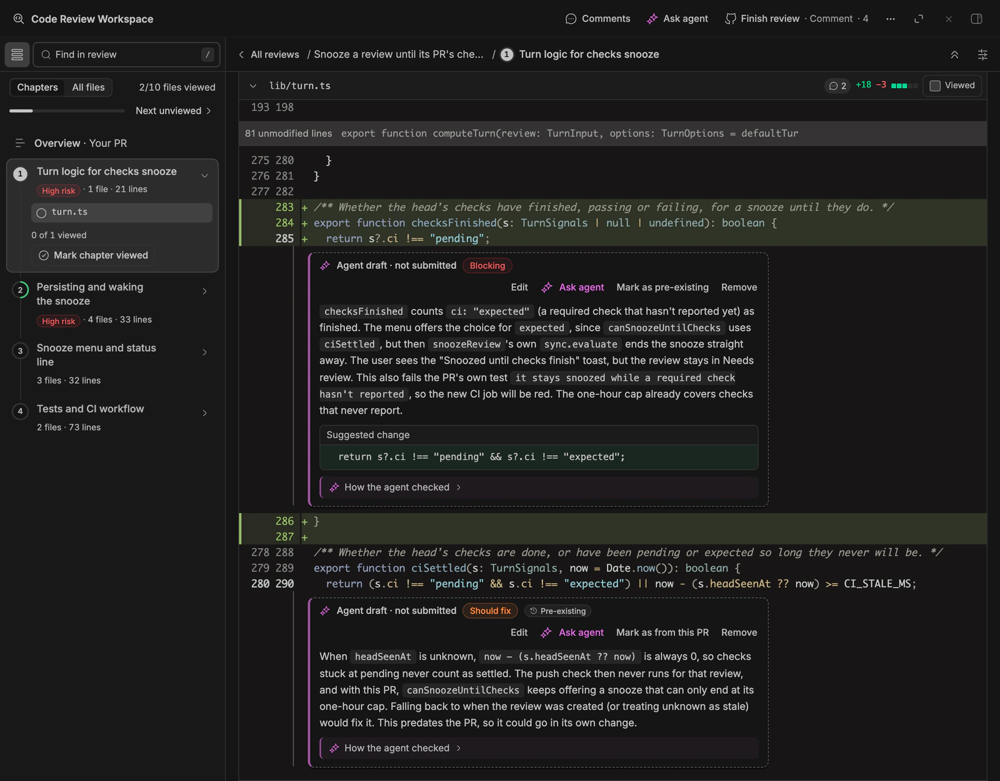

**Agent-drafted comments:** severity-tagged drafts with suggested changes, which you edit or remove.

## What you can do

### Know where to look before you read a line

An agent writes a guide to the change: what it does and why, then chapters in reading order, each with a risk level. The Overview starts you on the lines most likely to hide a defect.

- **Start here** lists the one to three riskiest lines, each a click from the code.
- **Requirements** checks what the PR's description and linked issues ask for against the diff: covered, partial, missing, or unclear, with evidence.
- Medium- and high-risk chapters say what to verify. **Dig deeper** asks the agent for a closer pass over one.
- Lockfiles, generated files, and diffs over 1,500 changed lines start folded. The reading-time estimate skips lockfiles and generated files.

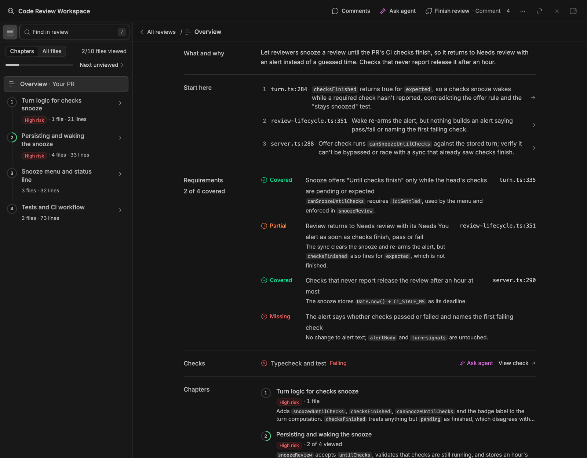

**Chaptered guide:** the Overview shows what changed, where to start, requirement coverage and checks.

### Start from a drafted review, not a blank page

When the guide is ready, the review agent reviews the change and drafts line comments, a summary, and a suggested verdict. You keep, edit, or remove each one. Nothing posts until you submit.

- Each comment has a severity: **Blocking**, **Should fix**, **Question**, or **Nit**.
- A draft can carry a suggested change. **How the agent checked** says what it read or ran, with file:line, and stays in BB.
- The automatic review asks for at most 10 comments, each confirmed in the code.
- Problems the PR didn't introduce are marked **Pre-existing**, and don't count as blocking against Approve.
- Remove an agent's comment with a reason (**Wrong**, **Intended**, **Already known**, or **Not worth it**), and it won't raise it again unless the code changes.

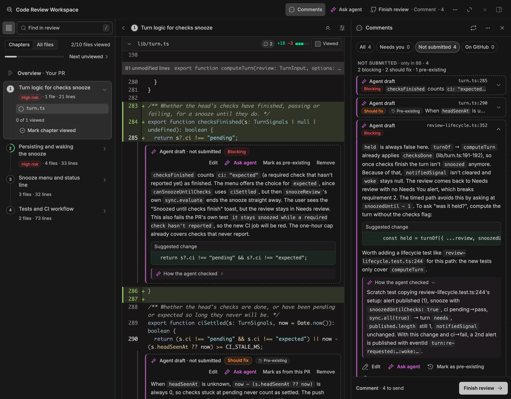

**Comments panel:** every draft in one place, by severity, with the agent's evidence.

### Get answers about any line without leaving the diff

**Ask agent** opens the review agent beside the code, in BB's own chat. It can read any file of the review: at the PR's head, at the diff's start, or at the commit you last reviewed.

- Ask about a line, a range, or selected text. The discussion stays under its line, private to you, and never posts.
- On a failing GitHub Actions check, **Ask agent** quotes the end of its failed log into the agent's box.
- The agent reads the PR's description, linked issues, commits, failing CI, other reviewers' open threads, and the repo's instruction files.
- **Pop out** turns the chat into a movable, resizable widget.

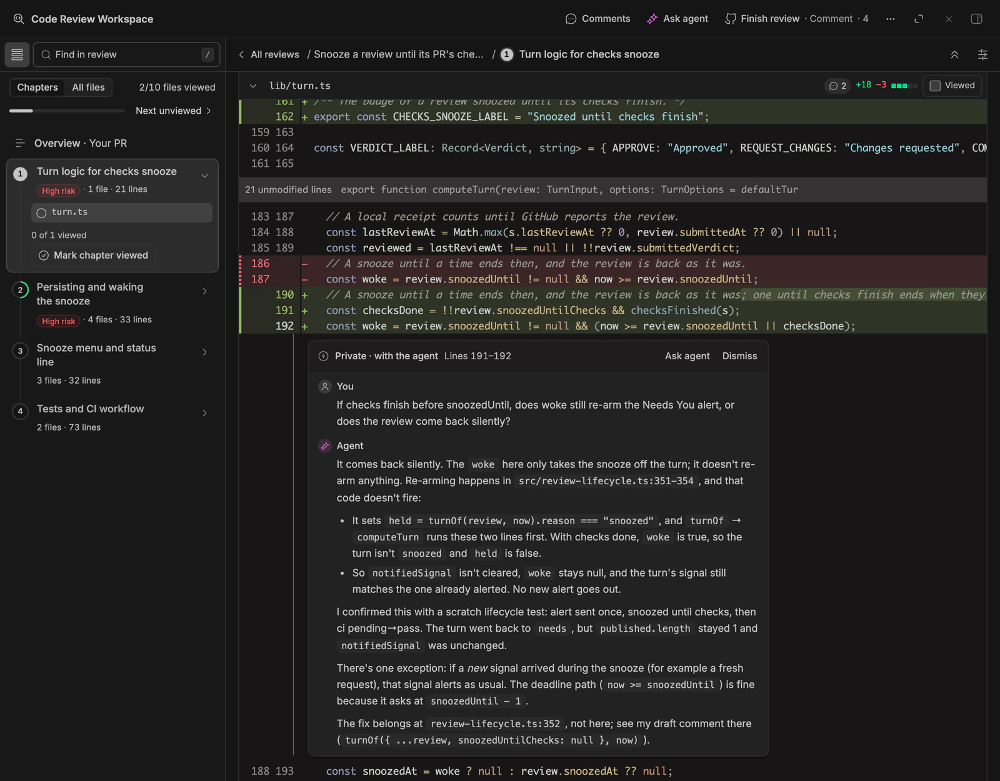

**Ask agent:** a private question about two lines, answered with file:line evidence.

### Post one review, checked before you approve

**Finish review** shows the summary, the verdict, and exactly what will be posted. **Submit to GitHub** posts it all as one review.

- The agent suggests a verdict. Only you pick it.
- While you approve, it flags blocking comments, unviewed files in high-risk chapters, chapters read faster than your set pace, and, when the agent suggests Approve, files it didn't read.
- It posts as the GitHub account it verified. If GitHub's answer is lost, it looks for the review it just posted rather than post it twice.
- After you submit, it offers the next review that needs you.

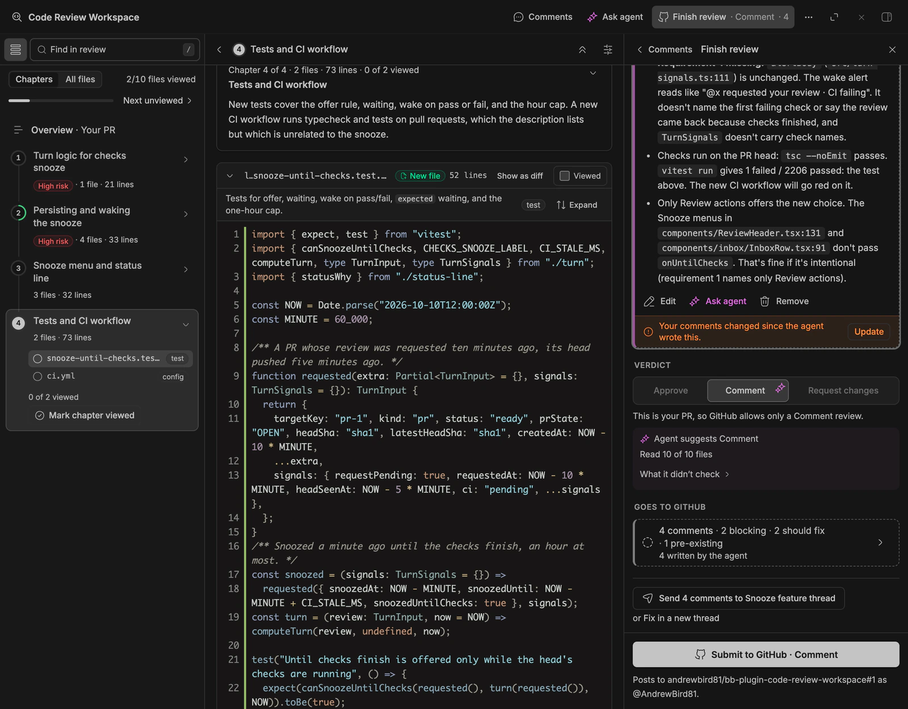

**Finish review:** you submit one review, with the summary and verdict in view.

### See whose turn it is

**All reviews** sorts every review into Needs review, Waiting on author, Reviewed, and Archive. A push alone never makes a review your turn: authors often push one fix at a time.

- A re-request, a question for you, a mention, or your feedback being handled brings a review back.
- PRs that request your review join the list from GitHub.
- Rows show checks, size, and your feedback's progress, such as `2/5 addressed`. Stacked PRs sit together, bottom first.
- **Snooze**, **Pin**, and **Archive** set reviews aside, each with Undo. BB's thread list shows Needs review too.
- **Rename…** gives a review a name of your own in your lists; its Overview keeps the PR's title under it, and nothing changes on GitHub.
- With the separate Needs You plugin, you get an alert when a guide is ready or a review becomes your turn.

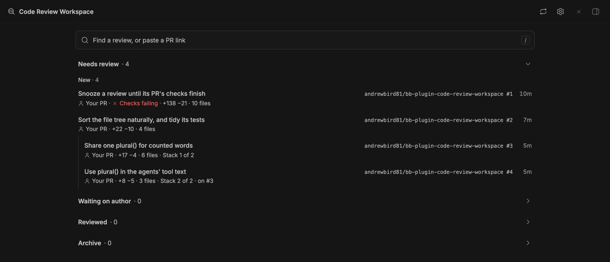

**All reviews:** each row shows whose PR it is, its checks, its size, and its place in a stack.

### Re-review only what changed

After new commits, **Since your review** shows only what changed since the commit you reviewed. The review agent checks your earlier feedback against it before you start.

- Rebases and merges from the base branch don't show up as changes.
- The agent marks each of your earlier threads, and each ask in your review summary, **Addressed**, **Partial**, **Not addressed**, **Author disagrees**, or **Unclear**, with one line of evidence.
- It drafts replies to your threads. Each waits until you choose **Send reply**.
- **Request what's left** drafts a Request changes listing what's still open.
- Compare with any earlier commit of the PR, not just your last review.

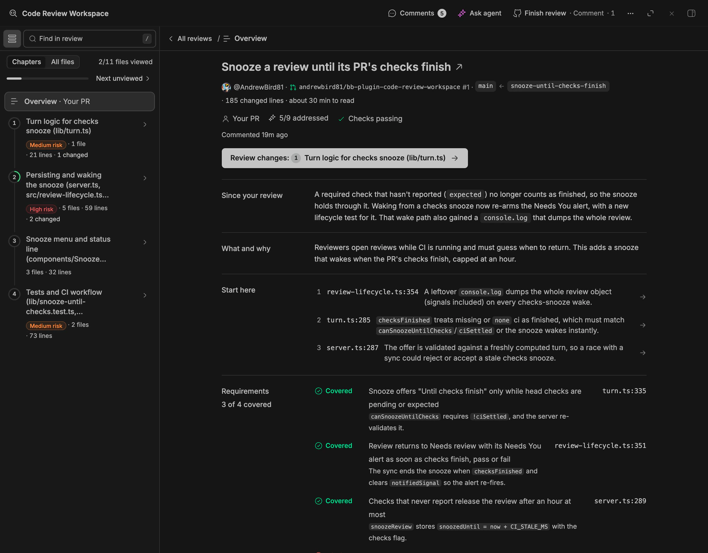

**Since your review:** what changed since you reviewed, and where to look first.

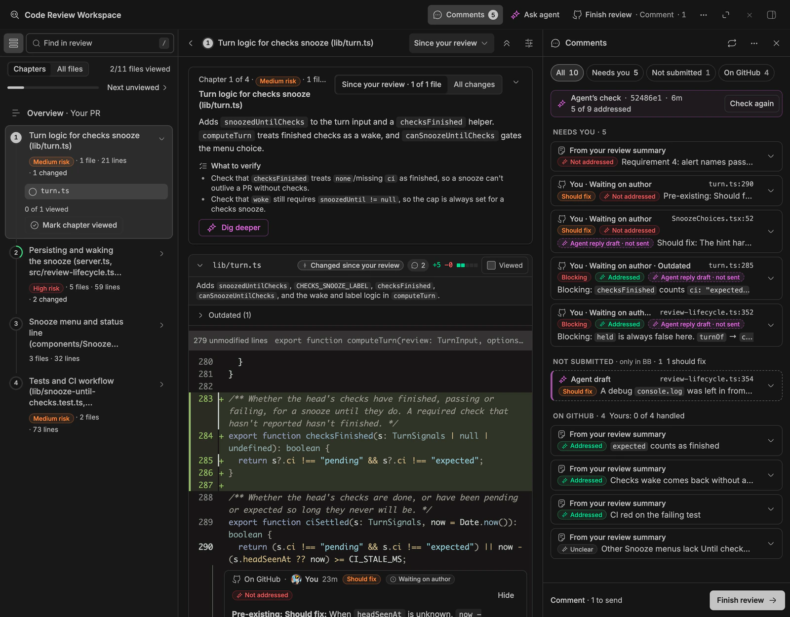

**Re-review check:** each earlier comment is scored against the new commits.

### Catch what a quick read misses

Some changes look harmless in a diff. The plugin marks them where you'll see them, before you read the code.

- A lockfile shows the packages it adds and removes, and warns when one downloads from a host other than its registry. The agents get the same summary.
- A test file whose diff removes assertions or skips tests says so: "3 assertions removed · 1 test skipped". The agents are asked to check it.
- Hidden bidirectional Unicode in a path or an added line gets a warning: it can make code read differently than it runs.
- CI failures with annotations show under the line that failed, with **Comment** and **Ask agent**.
- A Markdown file can show **Rendered**, as GitHub's rich diff does: added, changed, and removed blocks, list items and table rows marked, changed words struck and underlined, changed links said, and comments on its blocks, rows, code lines, or selected lines that post to the lines GitHub takes.

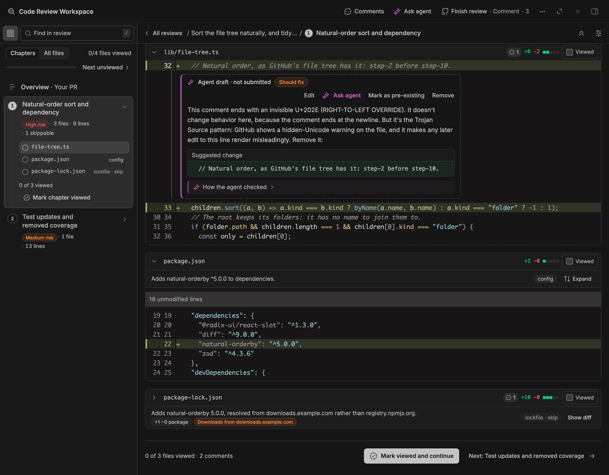

**Supply-chain flags:** new packages and non-registry download hosts are flagged on the lockfile.

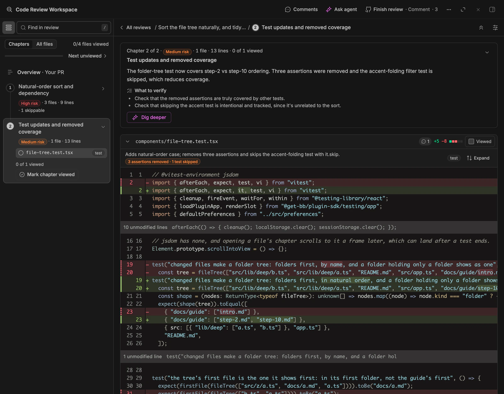

**Test-integrity flags:** removed assertions and skipped tests are called out.

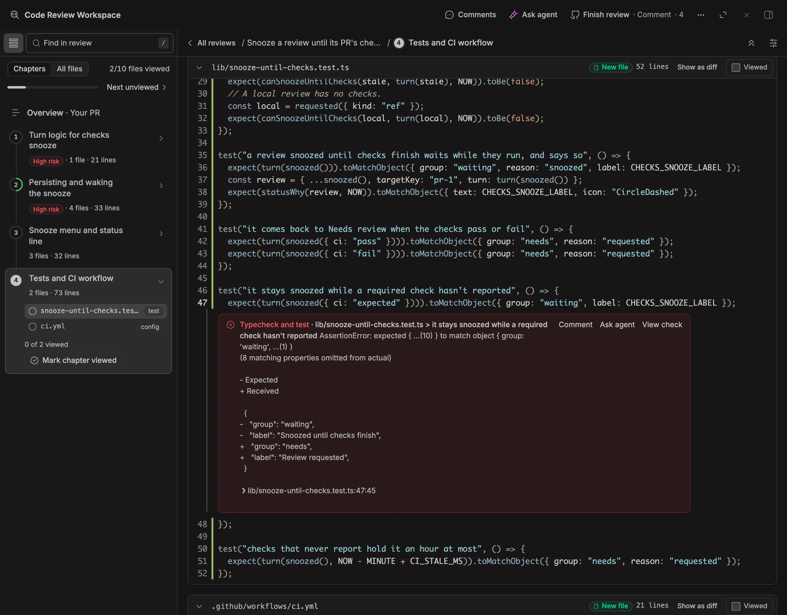

**CI failures in the code:** a failing check shows under the line that failed.

### Agents draft; only you post

- None of the plugin's agent tools posts to GitHub. `bb review comment` and `bb review summary` change only the local draft. A review, reply, or resolve posts only when you click it. See [What the agents can and can't do](docs/guide.md#what-the-agents-can-and-cant-do).
- By default, agents start on their own only on your own PRs, local reviews, and PRs from the repository's owner, members, and collaborators, and not on a branch in someone else's fork. You can change who in Settings. PR text reaches them fenced as untrusted data, and the repo's instruction files are read from the PR's base, never its head.

### Hand fixes back to the agent that wrote the code

Run `bb review` in the BB thread that made a change, and the review remembers that thread. Finish review can then send your comments straight back to it.

```sh
bb review main                       # your working tree against main
bb review my-feature --base main     # what the branch changed since it left main
bb review https://github.com/acme/web/pull/42
```

- On your own PR or a local review, Finish review sends the comments you pick to that thread, or starts one with **Fix in a new thread**. Nothing goes to GitHub.
- Agents in your threads can add draft comments and a summary with `bb review comment` and `bb review summary`. They change only the local draft.
- **Open in editor** opens a local review's file at the line.

### Review from the keyboard, the palette, or your phone

- Single keys move through files, chapters, changes, and comments, and mark files viewed. `?` lists them.
- BB's command palette offers **Next review that needs me** (⌘⇧U on a Mac) and **Review PR from clipboard**.
- On a phone, a dock at the bottom holds the chapters, Comments, Ask agent, and Full screen. On touch screens, iPads included, every control is a 44px target.
- Every feature that can get in the way has a switch in Settings. You pick each agent's provider, model, effort, and machine.

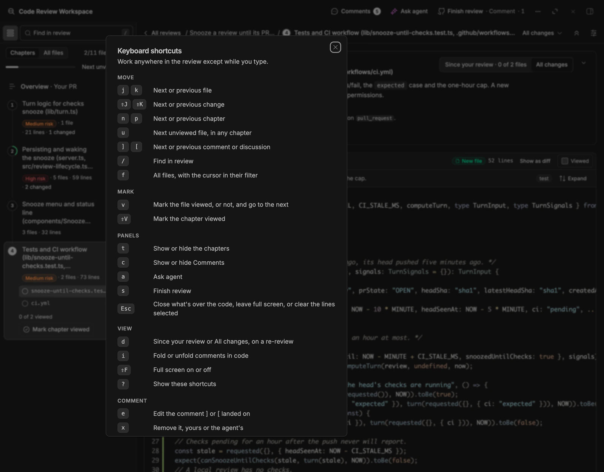

**Keyboard-first:** move, mark and comment without leaving the keyboard.

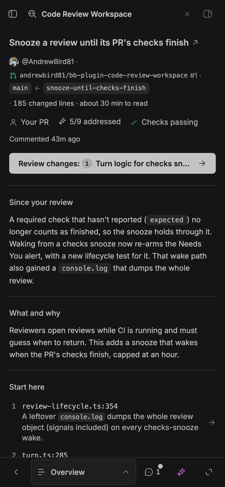

**Phone layout:** the same review reads on a phone.

## Is this for you?

- **Yes,** if you want an agent's draft to start from, and the final say on every word that posts.
- **Not for** posting an agent's findings one by one. Rob Ennals' [Code Review](https://github.com/robennals/bb-plugins/tree/HEAD/plugins/code-review) plugin does that.

## Requirements

- **BB 0.45 or later** (plugin SDK 0.6.14+), running on **Node 24 or later**. No npm or build step is needed.
- **`git` and GitHub CLI (`gh`)** on the machine running BB (the BB server), signed in to github.com. No token is pasted into the plugin.
- **A BB agent provider**, connected in BB's Settings. Guides and reviews use its normal usage allowance.
- **At least one BB project.** A review you start from the panel runs in your Personal project, or in the first project if there's none.
- **Optional: Needs You** (plugin id `inbox`), 0.2.0-beta.3 or later, for alerts. It's a separate plugin, listed in the BB Community marketplace ([source](https://github.com/notpritam/bb-plugin-inbox)). See [Notifications](docs/guide.md#notifications).

Limits:

- GitHub features support github.com only.
- A local review needs its checkout on the BB server. A checkout only on another enrolled machine isn't supported.
- Each reviewer uses their own BB installation and GitHub identity. On a shared BB server, credentials, settings, and saved reviews are shared.

## Quick start

1. Install Code Review Workspace from its Git repository:

   ```sh
   bb plugin install git:github.com/AndrewBird81/bb-plugin-code-review-workspace@^1.0.0
   ```

2. On the BB server, sign in to GitHub: `gh auth login --hostname github.com`.
3. Open **Code Review Workspace** in BB's sidebar. With no reviews yet, **All reviews** checks your setup.
4. Paste a GitHub PR link into the box on **All reviews**, and choose **Review** or press Enter. The guide writer builds the guide; then the review agent drafts comments, a summary, and a verdict.
5. On the review's Overview, choose **Start reading** and go through the chapters. Edit or remove the agent's comments, and add your own.
6. Open **Finish review**, pick a verdict, and choose **Submit to GitHub**.

For a local change, run `bb review main` in a BB thread whose project checkout is on the BB server. See [Local changes and the command line](docs/guide.md#local-changes-and-the-command-line).

## Moving from Guided Review

Until 1.0.0 this plugin was Guided Review, with the id `guided-review`. BB keeps a plugin's data under its id, so Code Review Workspace is a new install beside it, not an update. Don't update Guided Review to 1.0.0: install Code Review Workspace beside it.

1. Submit or save any comment you're typing, and close Guided Review's pages.
2. `bb plugin disable guided-review`. It keeps its data; disabling it stops both plugins following your PRs and starting agents at once, and both registering `bb review`.
3. `bb plugin install git:github.com/AndrewBird81/bb-plugin-code-review-workspace@^1.0.0`
4. Open **Code Review Workspace** and check your reviews are there. `bb plugin logs code-review-workspace` says "Brought in the reviews from guided-review" when it copied them.
5. Then `bb plugin remove guided-review`, which can delete its data. Until then, you can go back by removing Code Review Workspace and enabling Guided Review.

What it copies, and what it doesn't: [What carries over from Guided Review](docs/guide.md#what-carries-over-from-guided-review).

## Learn more

- [The full guide](docs/guide.md): every screen, setting, and command in detail.
  - [Install and first run](docs/guide.md#install-and-first-run), [Updates](docs/guide.md#updates), and [Upgrading from older versions](docs/guide.md#upgrading-from-older-versions).
  - [Local changes and the command line](docs/guide.md#local-changes-and-the-command-line): every form of `bb review`.
  - [The review workspace](docs/guide.md#the-review-workspace), [Keyboard shortcuts](docs/guide.md#keyboard-shortcuts), and [Phone and iPad](docs/guide.md#phone-and-ipad).
  - [Whose turn](docs/guide.md#whose-turn): what brings a review back, Snooze, Rename, and notifications.
  - [Comments and Finish review](docs/guide.md#comments-and-finish-review).
  - [Customize your reviews](docs/guide.md#customize-your-reviews): every setting and its default.
  - [Data and access](docs/guide.md#data-and-access): what the agents can and can't do, and what they read.
  - [Troubleshooting](docs/guide.md#troubleshooting) and [Uninstall](docs/guide.md#uninstall).
- [docs/development.md](docs/development.md): building, testing, and the browser regression test.
- [docs/operations.md](docs/operations.md): updates, how often GitHub is read, and Needs You delivery, for whoever runs the BB server.
- [docs/devices.md](docs/devices.md): the phone, iPad, and foldable layouts in full.
- [DESIGN.md](DESIGN.md): the interface system.
- [PRODUCT.md](PRODUCT.md): what the plugin is for and its operating limits.
- [CHANGELOG.md](CHANGELOG.md): release changes.

## Credits and license

Maintained by [Andrew Bird](https://github.com/AndrewBird81). Code Review Workspace began as a fork of [notpritam/bb-plugin-guided-review](https://github.com/notpritam/bb-plugin-guided-review) (0.2.1) by [Pritam Sharma](https://github.com/notpritam), who wrote the original plugin.

- Inspired by [plannotator/guides](https://github.com/plannotator/guides). The viewer and generation workflow here run through BB.
- The icons are from Hugeicons' free set, copied into `components/ui/icon-data.ts` under its MIT license.

Released under the [MIT License](LICENSE).
